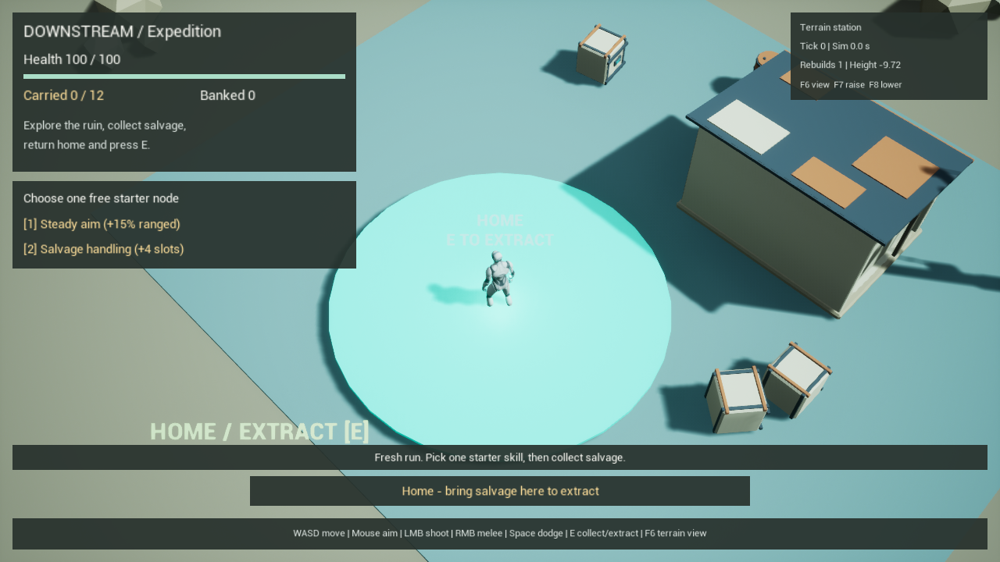
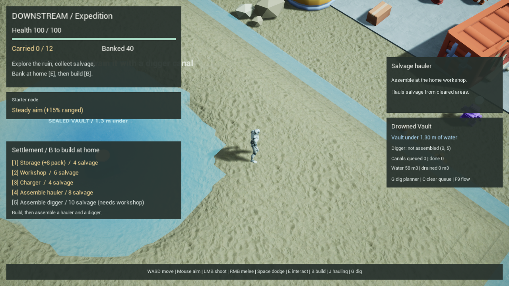
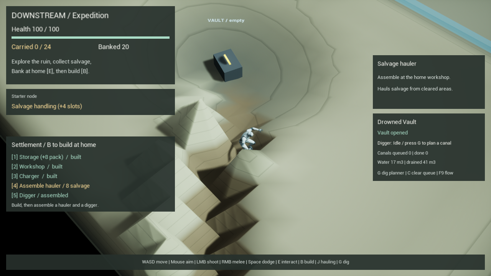
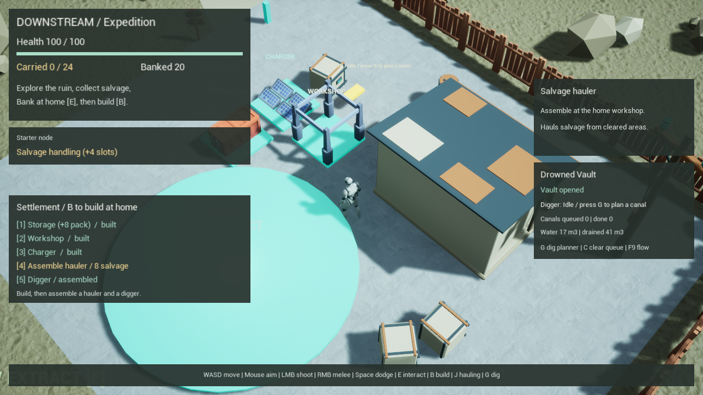
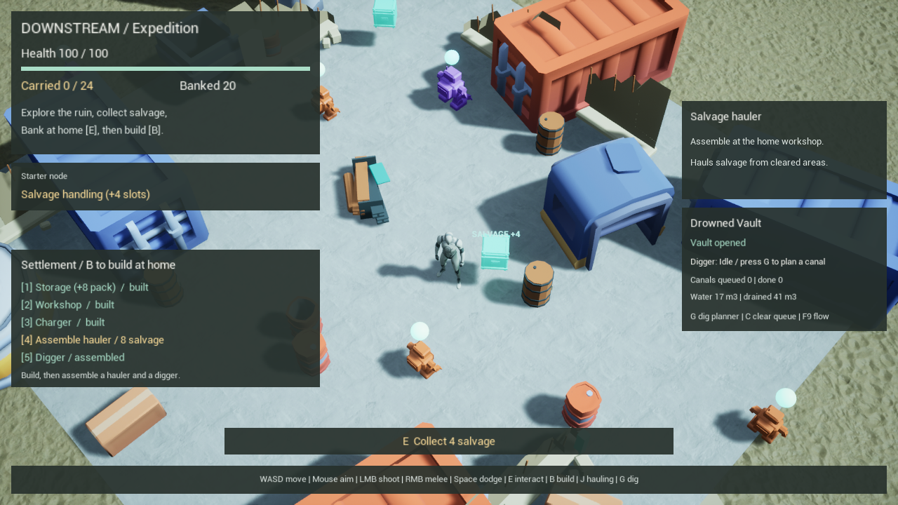

# DOWNSTREAM

DOWNSTREAM is a native Unreal Engine 5.8 single-player isometric expedition prototype. It opens on a **main menu** over a live preview world. **The Frontier** (`M2_World`) is a seeded procedural world where Dam Cult outposts sit below the rivers behind earth levees: cut a canal through a levee and the river drowns the base, while engineers sandbag the breach and the garrison hunts your digger (see [FRONTIER](docs/FRONTIER.md)). The **Training Grounds** (`M1_Expedition`) contains a home clearing, a salvage route, an industrial ruin, two enemy behaviors, combat, collection, extraction, death recovery and a persistent stash; a buildable home settlement with a hauling robot; and the **Drowned Vault**, a flooded site with simulated water that a digger robot drains by cutting a canal you draw. The owner's 2026-10-09 request prioritized a working gameplay concept before the remaining M0 performance work.

## Play

Double-click **Launch_DOWNSTREAM.cmd** in the repository. It opens the main menu in a separate game window: Continue / New frontier (pick or roll a seed) / Training grounds / Settings / Controls / Quit. **Launch_Training_Grounds.cmd** goes straight to the first map. Esc in game opens the pause menu (resume, settings, controls, back to menu, quit; progress is saved as you go). From this repository root, the equivalents are:

```powershell
powershell -ExecutionPolicy Bypass -File scripts/play.ps1               # main menu
powershell -ExecutionPolicy Bypass -File scripts/play.ps1 -Frontier     # continue the saved frontier
powershell -ExecutionPolicy Bypass -File scripts/play.ps1 -Frontier -Seed 1234   # fresh frontier, seed 1234
powershell -ExecutionPolicy Bypass -File scripts/play.ps1 -Classic      # training grounds
```

Settings (volume, window mode, resolution, quality preset, FPS counter, HUD hints) save to `GameUserSettings.ini`. The frontier saves to `Saved/Downstream/world-save.json` (schema 4) and the training grounds keep `prototype-save.json`; starting a new frontier replaces only the frontier save.

| Control | Action |
| --- | --- |
| WASD | Move relative to the fixed isometric camera |
| Mouse | Aim |
| Left mouse, hold | Fire projectiles; ammunition is unlimited |
| Right mouse | Nearby melee strike |
| Space | Dodge in the movement direction, or facing direction while standing. In a trench deeper than 0.5 m: scramble up the bank |
| E | Collect nearby salvage; open the drained vault; at home, extract and heal |
| 1 | Choose Steady Aim: +15% ranged damage (builder open: select storage) |
| 2 | Choose Salvage Handling: +4 carrying slots (builder open: select workshop) |
| B | At home: open/close the builder. 1-3 select storage/workshop/charger, LMB place, RMB cancel, 4 assemble hauler, 5 assemble digger |
| J | Enable/pause the hauler's salvage job |
| G | Dig planner: drag LMB from the water to where it should drain; RMB cancels, G closes |
| Shift + mouse wheel | In the dig planner: canal depth below grade, 0-3 m in 0.25 m steps (default 1 m) |
| C | Clear the queued canals |
| F9 | Water flow/depth developer overlay |
| F10 | Developer: respawn every dead enemy and looted cache now |
| F11 | Developer: +25 banked salvage |
| Esc | Pause menu |

**The Frontier.** Each seed is a 112 x 88 m world: two rivers, your home on dry high ground, up to three Dam Cult outposts, a drowned vault, ten caches and six patrols. Outposts sit 1.3 m below a river behind a 3 m levee. Build the workshop and digger at home, then plan a canal (G) from the river through the levee. Flooded structures lose integrity and collapse into salvage (stash 12, generator 6, huts 3). Engineers (yellow) sandbag the breach; guards and riflemen go for your digger when it works near their levee. While the generator stands it pumps the bowl dry and the garrison reinforces every 45 s; destroy it and the outpost is razed for good. A wrecked digger reassembles at the workshop after 25 s for 4 salvage. The HUD shows the digger's health and the nearest outpost's state.

Training grounds: enemies and the three field caches respawn: a killed enemy returns to its spawn after 60 s and a looted cache refills after 120 s, but only while you are more than 18 m from that spot (tuning: `EnemyRespawnSeconds`, `CacheRespawnSeconds`, `FieldRespawnSafeRadius`). Explore, fight, collect, then return to the green home area and press E. Six chasers and three shooters guard three caches containing four salvage each. Defeated enemies drop two salvage. Base carrying capacity is 12; a pickup must fit in full. Home's 340 cm radius protects the player from damage. Death leaves carried salvage in a recovery bag and respawns the player at home after 1.5 seconds. The HUD shows health, carry, bank, interaction prompts and the starter choice.

Choose one free starter node; the choice and banked salvage persist across launches. Carry, enemies, field pickups and recovery bags reset on a fresh launch. Quitting does not bank carried salvage. The default save is `unreal/Downstream/Saved/Downstream/prototype-save.json`; see [save and test contracts](tests/EXPEDITION_TESTS.md) before modifying it.

**Settlement.** At home, B opens the builder. Storage (4 salvage, +8 pack), workshop (6) and charger (4) snap to a grid in the home clearing. With all three, assemble one hauler (8) that collects loose salvage away from living hostiles, banks it at storage and recharges. See [SETTLEMENT_TESTS](tests/SETTLEMENT_TESTS.md).

**Drowned Vault.** South-east of the ruin, a burst main keeps a basin flooded 1.3 m deep over a sealed vault. Assemble a digger at the workshop (5, 10 salvage), press G and drag a canal from the basin to the old culvert on the south edge. The digger cuts it step by step, the water drains, and E opens the vault for 16 salvage. Water slows anyone wading in it. Dug terrain, the digger and the vault state persist (save schema 3). See [WATER_SITE](docs/WATER_SITE.md).

For editing, open `unreal/Downstream/Downstream.uproject`, then `/Game/Downstream/Maps/M1_Expedition`. M0_TestWorld remains a technical reference, launched with `scripts/play.ps1 -TechnicalMap`. There, F6 toggles the terrain station view and F7/F8 queue height edits; this debug mesh has no gameplay collision or navigation and is no longer placed in M1.

## Current delivery and evidence

The project now compiles native **Editor and Game** targets. Its simulation adapter runs at 10 Hz on the game thread, and DownstreamRender presents one dirty terrain patch. Canonical source is `native/Source`; the build script maintains the ignored `unreal/Downstream/Source` mirror. Edit canonical files only.

The 17 standalone simulation tests, expedition economy suite and all eight native Unreal automation cases passed. Game-world verification passed movement, projectiles, melee, both enemy attacks, home protection/healing, collection/extraction, death/respawn/recovery and dodge. A separate process restored the bank and starter choice while resetting the field. The M0 native movement/terrain regression also passed. A standalone M1 frame was reviewed at 1280x720 with the visible player and readable HUD. [Validation results](docs/validation/2026-10-09-results.json) preserve the evidence; [M0_STATUS](docs/M0_STATUS.md) records remaining technical criteria.











Water/settlement evidence: [2026-10-09-water-results.json](docs/validation/2026-10-09-water-results.json).

This is an early gameplay slice. One settlement, two robot roles, the training-grounds water site and the seeded frontier with one enemy faction exist; diplomacy, a full skill tree, broader persistent world entities, more water structures (gates, dams, pumps), weather and endgame progression remain future work. Actor/Mass comparison, worker-thread snapshots and a packaged RTX 5050 / 1080p / 60 FPS benchmark are also open.

## Build and verify

Run PowerShell from this repository root. Save and close project editors before rebuilding DLLs. Run builds, map generation and editor verification sequentially to avoid Windows package locks.

```powershell
powershell -ExecutionPolicy Bypass -File scripts/build_native.ps1
powershell -ExecutionPolicy Bypass -File scripts/test_sim.ps1
powershell -ExecutionPolicy Bypass -File scripts/test_expedition.ps1
powershell -ExecutionPolicy Bypass -File scripts/test_settlement.ps1
powershell -ExecutionPolicy Bypass -File scripts/test_water.ps1
powershell -ExecutionPolicy Bypass -File scripts/test_native.ps1
powershell -ExecutionPolicy Bypass -File scripts/verify_expedition.ps1
powershell -ExecutionPolicy Bypass -File scripts/verify_settlement.ps1
powershell -ExecutionPolicy Bypass -File scripts/verify_water.ps1
powershell -ExecutionPolicy Bypass -File scripts/verify_play.ps1
powershell -ExecutionPolicy Bypass -File scripts/test_world.ps1
powershell -ExecutionPolicy Bypass -File scripts/verify_frontier.ps1
```

`test_world.ps1` checks the world generator and outpost flooding on 80 seeds. `verify_frontier.ps1` plays the main menu, a full frontier run (seed 3) and a reload in isolated PIE sessions. `verify_expedition.ps1`, `verify_settlement.ps1` and `verify_water.ps1` use isolated save directories under `build/` and a separate process to verify reload, preserving the owner's normal save. `verify_play.ps1` checks movement, camera and the M0 native terrain station. Logs and generated reports are ignored under `build/`.

On another machine, install compatible Unreal 5.8 and Visual Studio C++ tools/Windows SDK, update `scripts/project_paths.ps1`, and reassociate the project with that engine installation. Run `scripts/setup_test_compiler.ps1` once if the portable compiler for plain C++ tests is absent. This PC uses UE 5.8.3, Visual Studio Community 2026, MSVC 14.44.35229 and SDK 10.0.26100.0; [TOOLCHAIN](docs/TOOLCHAIN.md) explains compatibility and source synchronization.

## Regenerate content

Committed maps/assets can be played without regeneration. Rebuild original meshes with Blender 5.2 using `art/create_blockouts.py`, then `art/validate_blockouts.py`. `scripts/create_prototype_audio.py` generates four original PCM cues with standard Python. Build native targets before running Unreal Python scripts that use native classes.

For a full base-map rebuild, run `scripts/regenerate_world.ps1`, then `scripts/install_native_layer.py` through Unreal's Python commandlet to attach the terrain station to M0. Then run `scripts/regenerate_expedition.ps1` to create/update M1 gameplay actors, materials and audio references, and save navigation. Finally `scripts/regenerate_frontier.ps1` builds `M2_World` and `MainMenu`, the world ground and flowing-water materials, imports the frontier audio and ripple texture, and bakes M2 navigation. M1 copies M0 only on its first creation; later regeneration retains that existing environment. Both map generators replace generated actors. Keep hand-authored variants under another map name. [PLAYABLE_CONCEPT](docs/PLAYABLE_CONCEPT.md) includes the commandlet invocation and sequence.

Open-source art: CC0 models from Kenney (survival, industrial, factory and space kits) and CC0 PBR textures from ambientCG are retained under `third_party/` with licenses and hashes, and imported by `scripts/import_third_party.ps1` (run it before `regenerate_expedition.ps1` on a fresh checkout). Native code falls back to the original blockouts if they are missing.

The nine original meshes retain editable Blender source, FBX exports, palette and validation manifests in `art/`. Epic's mannequin and template resources retain their existing content mounts. [ASSET_LICENSES](ASSET_LICENSES.md) records provenance. The owner-installed AdaptivePathfindingSystem plugin is enabled locally; gameplay uses standard Recast/AIController. If that optional plugin is absent on another machine, disable its project entry before opening/building. Harvest/Ready Map payloads and the separate UE4.27 Shooter Game sample are not dependencies of this level.

## Future agent handoff

Read [AGENTS](AGENTS.md), [FRONTIER](docs/FRONTIER.md), [PLAYABLE_CONCEPT](docs/PLAYABLE_CONCEPT.md), [WATER_SITE](docs/WATER_SITE.md), [SETTLEMENT_TESTS](tests/SETTLEMENT_TESTS.md), [ARCHITECTURE_DECISIONS](docs/ARCHITECTURE_DECISIONS.md), [TOOLCHAIN](docs/TOOLCHAIN.md), [EXPEDITION_TESTS](tests/EXPEDITION_TESTS.md) and [M0_STATUS](docs/M0_STATUS.md). The playable concept records the loop, tuning seam, module ownership, generation workflow and next work. The [v0.3 design brief](docs/reference/DOWNSTREAM_Design_Doc_v0.3.md) and dated specs/plans supply design context and history.
